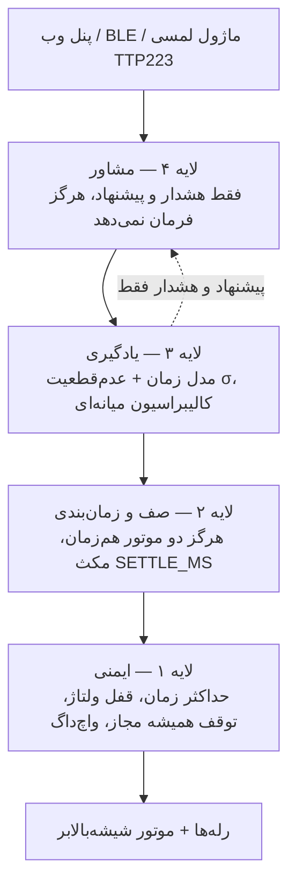

<div align="center">

# Car Control Pro · ESP32-S3

**کنترلر هوشمند شیشه‌بالابر خودرو با ESP32-S3 — پنل وب داخلی، OTA، پل BLE و تخمین موقعیت بدون سنسور موقعیت**

[](https://github.com/soheylsajasi22-dotcom/ESP32-Projects/actions/workflows/build.yml)
[](LICENSE)
[](platformio.ini)
[](src/)
[](docs/API.md)

</div>

---

## English summary

**Car Control Pro** is a self-contained smart window-regulator controller for a car, built on the
**ESP32-S3**. The firmware runs in **Access-Point mode** (no router, no cloud), serves a full
**RTL web panel from flash**, and can update itself **over the air**. It also exposes the same
control engine over **BLE** (JSON line protocol) for a phone app.

The hard problem here is that a cheap car window motor has **no position feedback**. This project
solves that with a *time-model + uncertainty* estimator, multi-sample calibration and
**voltage-sag end-of-travel detection** — and, crucially, with a safety layer that can never be
overridden by the estimator.

| | |
|---|---|
| **Platform** | ESP32-S3 DevKitC (Arduino / PlatformIO) |
| **Runtime** | Wi-Fi AP + embedded HTTP server (single file, no LittleFS) |
| **Update** | OTA via ElegantOTA (HTTP, optional Basic Auth) |
| **Mobile** | BLE bridge with token auth, chunked transfer, line-delimited JSON |
| **Hardware in** | 4–6 × TTP223 touch modules, INA219 (voltage/current) |
| **Hardware out** | 4 × relays (2 windows × up/down) via 2N2222 + flyback diode |
| **Code** | ~1560 lines of single-file Arduino C++ (`src/`) |
| **License** | MIT (see third-party note in `LICENSE`) |

**Highlights**

- **Four-layer safety-first architecture** — safety, scheduling, learning, advisory.
- **Six hard invariants** (I1–I6) documented and enforced in code.
- **Never two motors at once** — automatic scenes run through a serialised queue with a settle delay.
- **Position estimation without position sensors** — median-of-3 calibration, σ uncertainty model,
  voltage-sag end-stop detection, speed correction with battery voltage.
- **Touch gestures** — double tap = auto, triple tap = custom scene, with a configurable threshold.
- **Diagnostics tab** — live touch inputs, per-relay test, voltage telemetry, CSV log export.
- **Ring-buffer logging** in RAM + persisted to NVS across reboots.

📄 Full docs: [`docs/ARCHITECTURE.md`](docs/ARCHITECTURE.md) · [`docs/WIRING.md`](docs/WIRING.md) · [`docs/API.md`](docs/API.md)

---

## فارسی — معرفی

**Car Control Pro** یک کنترلر کامل شیشه‌بالابر هوشمند برای خودرو است که روی **ESP32-S3** اجرا می‌شود.
 firmware به‌صورت **Access Point** بالا می‌آید (بدون نیاز به مودم یا اینترنت)، یک **پنل وب کامل راست‌به‌چپ**
را از داخل حافظه سرو می‌کند و قابلیت **به‌روزرسانی بی‌سیم (OTA)** دارد. همان موتور کنترلی از طریق
**BLE** هم برای اپ موبایل در دسترس است.

مسئله اصلی این پروژه سخت‌افزاری است: موتور شیشه‌بالابر ارزان **هیچ فیدبک موقعیتی** ندارد.
راه‌حل این پروژه، یک **مدل تخمین موقعیت مبتنی بر زمان + عدم‌قطعیت** است، به‌همراه کالیبراسیون
چندنمونه‌ای و **تشخیص لبه مسیر با افت ولتاژ** — و در کنار آن یک لایه ایمنی که هرگز اجازه نمی‌دهد
تخمین، ایمنی را دور بزند.

### ویژگی‌ها

| حوزه | جزئیات |
|---|---|
| **ایمنی** | حداکثر زمان رله، قفل ولتاژ پایین (Low-Voltage)، زمان مرده بین جهت‌ها، قطع رله هنگام OTA، واچ‌داگ سخت‌افزاری، توقف همیشه مجاز |
| **زمان‌بندی** | صف صحنه‌ها: هرگز دو موتور هم‌زمان روشن نمی‌شوند؛ اول راننده، بعد شاگرد، با مکث بین آن‌ها |
| **تخمین موقعیت** | مدل زمان + عدم‌قطعیت σ؛ کالیبراسیون با میانه ۳ نمونه؛ تشخیص لبه مسیر با افت ولتاژ؛ اصلاح سرعت با ولتاژ باتری |
| **لمسی** | ۴ تا ۶ ماژول TTP223؛ لمس کوتاه = حالت اتوماتیک، لمس بلند = کنترل دستی؛ دابل‌تپ/تریپل‌تپ برای اجرای صحنه |
| **پنل وب** | تک‌فایل داخل firmware (بدون LittleFS)، رابط فارسی RTL، تم روشن/تاریک، دیاگنostics، نمودار ولتاژ، خروجی CSV لاگ |
| **OTA** | ElegantOTA روی مسیر `/update` با امکان فعال‌سازی Basic Auth |
| **BLE** | پل کنترلی با احراز هویت توکن، انتقال تکه‌تکه داده و پروتکل JSON خط‌به‌خط |
| **پایداری** | واچ‌داگ سخت‌افزاری، حلقهٔ لاگ ۱۲۰ رویدادی در RAM + ماندگاری در NVS، `Preferences` برای تنظیمات |
| **رابط** | AP با نام `Car_Control_Pro`، آدرس `192.168.4.1`، و mDNS به نام `pride.local` |

### معماری چهار لایه



**ناورداها (invariants)** — این شش قاعده در کد تضمین شده‌اند و در `docs/ARCHITECTURE.md` توضیح داده شده‌اند:

| # | قاعده |
|---|---|
| **I1** | رلهٔ بالا و پایینِ یک شیشه هرگز هم‌زمان `HIGH` نیستند. |
| **I2** | هیچ حرکتی بیش از `mx` ثانیه (پیش‌فرض ۱۲) ادامه پیدا نمی‌کند. |
| **I3** | در مسیر خودکار/صحنه‌ها، در هر لحظه فقط یک موتور روشن است. |
| **I4** | توقف (`stop`) همیشه کار می‌کند و صف را خالی می‌کند. |
| **I5** | یادگیری هرگز ناورداهای I1–I4 را تغییر نمی‌دهد. |
| **I6** | قطع برق وسط حرکت = موقعیت نامعلوم (σ = ۱۰۰٪). |

### سخت‌افزار و سیم‌کشی

خلاصهٔ پین‌ها (جزئیات کامل در [`docs/WIRING.md`](docs/WIRING.md)):

| GPIO | نقش | توضیح |
|---|---|---|
| 4 / 5 | ورودی لمسی | شیشهٔ راننده — بالا / پایین |
| 6 / 7 | ورودی لمسی | شیشهٔ شاگرد — بالا / پایین |
| 8 / 9 | I²C (SDA/SCL) | INA219 — اندازه‌گیری ولتاژ و جریان |
| 10 / 11 | ورودی لمسی | پنل شاگرد (فعلاً غیرفعال: `HAS_PAS_PANEL = 0`) |
| 15 / 16 | خروجی رله | راننده — بالا / پایین |
| 17 / 18 | خروجی رله | شاگرد — بالا / پایین |
| 19 / 21 | خروجی رله | قفل / بازکردن مرکزی (فعلاً غیرفعال: پایه‌های USB روی S3) |
| 43 / 44 | UART | خروجی سریال دیباگ |

> ⚠️ **هشدار ایمنی:** برق خودرو ۱۲ ولت است. تبدیل به ۵ ولت با مبدل (کاهنده) و **فیوز** انجام شود.
> رله‌ها با درایور `2N2222` و **دیود محافظ (flyback)** روی هر بوبین رله سوار می‌شوند و زمین همهٔ
> ماژول‌ها مشترک است. حداکثر زمان رله و قفل ولتاژ پایین را قبل از راه‌اندازی جدی بگیرید.

### ساخت و فلش

**PlatformIO (پیشنهادی):**

```bash
git clone https://github.com/soheylsajasi22-dotcom/ESP32-Projects.git
cd ESP32-Projects
pio run                 # کامپایل فریم‌ور
pio run -t upload      # فلش روی برد
pio device monitor     # لاگ سریال
```

**Arduino IDE:** پوشهٔ `src/Car_Control_Pro_ESP32S3/` را باز کنید (نام پوشه باید با نام فایل
`.ino` یکی باشد) و کتابخانه‌های `ElegantOTA`، `ArduinoJson` و `NimBLE-Arduino` را نصب کنید.

> برای OTA باید از جدول پارتیشن `default.csv` استفاده کنید (دو اسلات app0/app1).
> در PlatformIO این تنظیم در `platformio.ini` آمده است.

### ساختار مخزن

```
ESP32-Projects/
├── src/Car_Control_Pro_ESP32S3/   # فریم‌ور اصلی (تک‌فایل، پنل وب داخل خودش)
├── web/index.html                 # نسخهٔ مستقل پنل وب برای مرورگر موبایل
├── docs/                          # معماری، سیم‌کشی، API، یادداشت‌های پروژه، چانج‌لاگ
├── releases/                      # آخرین فریم‌ور آمادهٔ فلش + MANIFEST
├── archive/                       # نسخه‌های قدیمی، اسکچ‌های اولیه و فایل‌های خام
└── platformio.ini                 # پیکربندی ساخت و CI
```

### مستندات

| فایل | محتوا |
|---|---|
| [`docs/ARCHITECTURE.md`](docs/ARCHITECTURE.md) | چهار لایه، ناورداها، مدل تخمین موقعیت، صف صحنه‌ها، لاگ و NVS |
| [`docs/WIRING.md`](docs/WIRING.md) | جدول پین‌ها، سیم‌کشی برق خودرو، درایور رله، ماژول‌های لمسی |
| [`docs/API.md`](docs/API.md) | تمام endpointهای HTTP، پروتکل BLE، پارامترهای `/cmd` |
| [`docs/CHANGELOG.md`](docs/CHANGELOG.md) | تاریخچهٔ نسخه‌ها و تغییرات |
| [`docs/PROJECT_NOTES.md`](docs/PROJECT_NOTES.md) | یادداشت‌های توسعه، باگ‌های رفع‌شده و تصمیم‌های مهندسی |
| [`releases/MANIFEST.md`](releases/MANIFEST.md) | فهرست فریم‌ورهای آمادهٔ فلش |

### مسیر توسعه

- [x] پنل وب تک‌فایل با OTA
- [x] تخمین موقعیت بدون سنسور + کالیبراسیون چندنمونه‌ای
- [x] تشخیص لبه مسیر با افت ولتاژ
- [x] پل BLE با احراز هویت
- [ ] افزودن سنسور موقعیت واقعی (Hall/encoder) و جایگزینی مدل تخمین
- [ ] اپ اندروید (WebView یا بومی BLE)
- [ ] کنترل مرکزی خودرو: قفل مرکزی، چراغ‌ها، راهبری

---

## پروژه‌های مرتبط

- [Arduino-ESP32 core](https://github.com/espressif/arduino-esp32)
- [ElegantOTA](https://github.com/ayushsharma82/ElegantOTA) · [ArduinoJson](https://github.com/bblanchon/ArduinoJson) · [NimBLE-Arduino](https://github.com/h2zero/NimBLE-Arduino)

## پروانه

MIT — جزئیات در [`LICENSE`](LICENSE). توجه: `ElegantOTA` با پروانهٔ AGPL-3.0 منتشر می‌شود.
